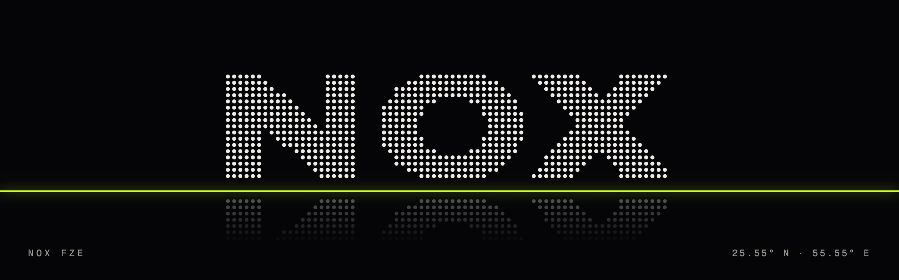

<picture>
  <source media="(prefers-color-scheme: dark)" srcset="./assets/banner-dark.png">
  <source media="(prefers-color-scheme: light)" srcset="./assets/banner-light.png">
  
</picture>

### Nox FZE

Nox FZE configures, operates, and maintains market data capture software to each customer's specification, with every hour sealed into a hash chain.

**A Lighter recorder for your team.** Nox FZE records the public channels of Lighter for your team, seals each UTC hour into a hash chain and delivers it into your own S3-compatible bucket within 15 minutes after the hour closes, unless your storage or the recorder is unavailable. From USD 250 a month, under [published team terms](https://noxfze.com/teams).

- **Check a real hour:** [in your browser](https://noxfze.com/verify), with one click and no account, or [from a terminal](https://noxfze.com/docs/verify).
- **Order in writing:** [noxfze.com/teams](https://noxfze.com/teams), or email [contact@noxfze.com](mailto:contact@noxfze.com?subject=Team%20recorder%20request%20%28teams%29) with the subject "Team recorder request (teams)".

[noxfze.com](https://noxfze.com) · [contact@noxfze.com](mailto:contact@noxfze.com) · [Bluesky](https://bsky.app/profile/noxfze.com) · Umm Al Quwain, United Arab Emirates

[Check a real sealed hour →](https://noxfze.com/verify) · [Check our registration ↗](https://uaqftz.gov.ae/licensing-services) · Est. 2025 · License No. 11054, Umm Al Quwain Free Trade Zone
